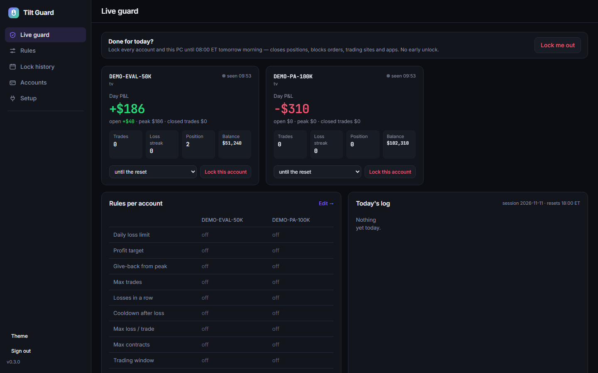
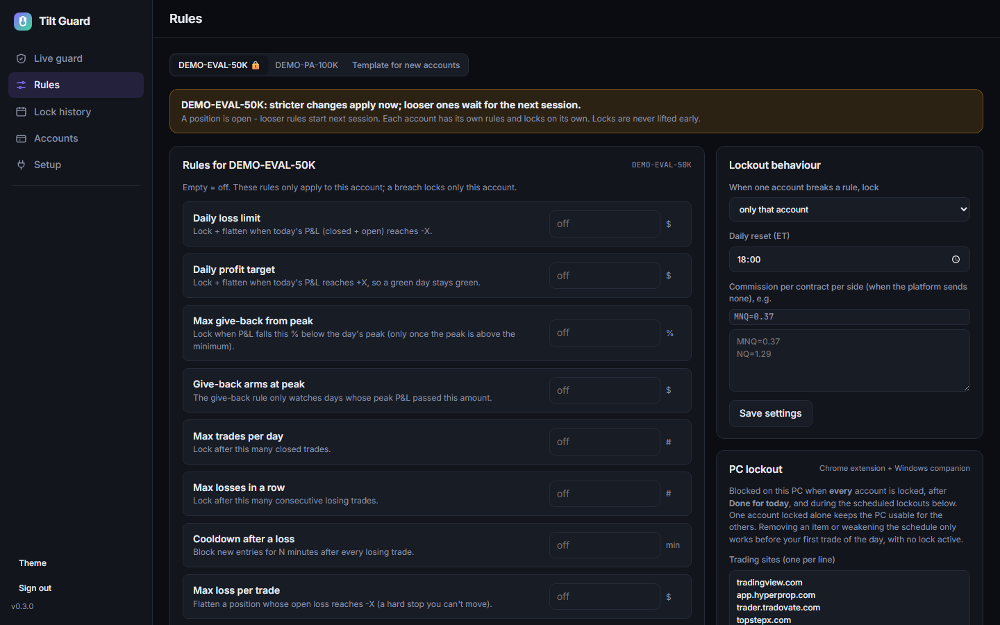

# TiltGuard

**Website:** https://aminou973.github.io/tiltguard/ · Free and open source, brought to you by [RangeProb](https://rangeprob.com/).

A daily lockout for futures day traders. You set daily rules (max loss, profit target, max trades, cooldown
after a losing streak, trading window). When a rule trips, TiltGuard locks you out for the rest of the day:
it blocks new entries, can flatten open positions, and can take trading sites and apps off your PC until the
lock expires.

> **Disclaimer:** Not financial advice. This project is for educational purposes only. It is provided as is,
> with no warranty. It can fail: a crash, a broken connection or a broker/platform change can stop it from
> blocking an order or flattening a position. You are responsible for your own trading and risk.





_Screenshots use demo accounts, not a real account._

## Pieces

| Folder | What it is |
|---|---|
| `backend/` | Python (FastAPI) server: rules engine, lock state, fill history, web dashboard (`backend/web`). Everything else talks to it. |
| `extension/` | Chrome extension (Manifest V3) for TradingView (Tradovate) and HyperProp: enforces locks in the browser, sends fills and account state. |
| `nt8/` | NinjaTrader 8 add-on: reports accounts, cancels new entries while locked, flattens when told to. |
| `desktop/` | Optional Windows tray app (.NET Framework 4.8): taskbar strip with day P&L / lock state, "Done for today" button, blocks sites and apps while locked. |
| `tools/import_nt8.py` | Imports NinjaTrader 8 execution history into TiltGuard. |

## Install and run

### Easiest: one click

1. Install [Python 3.10+](https://www.python.org/downloads/) (on Windows, tick **Add python.exe to PATH**).
2. [Download the ZIP](https://github.com/Aminou973/tiltguard/archive/refs/heads/main.zip) and unzip it.
3. Double-click **`start.cmd`** (Windows) or run **`./start.sh`** (macOS / Linux).

The first run installs everything, asks you to choose a dashboard password, prints your **device key**
(you paste it into the extension / NT8 add-on) and opens http://127.0.0.1:8940. Later runs just start it.

### Manual

```bash
cd backend
python -m venv .venv
.venv/Scripts/activate      # Windows; on macOS/Linux: source .venv/bin/activate
pip install -r requirements.txt
python server.py --set-password   # sets the web login and prints the device key
python server.py                  # http://127.0.0.1:8940
```

Open http://127.0.0.1:8940, sign in, and set your rules. Data (SQLite) is stored in `backend/data/`.

Run the tests: `python backend/tests/test_core.py` and `node extension/tests/<file>.test.js`.

### Chrome extension

1. Open `chrome://extensions`, enable Developer mode, click **Load unpacked**, pick the `extension/` folder.
2. Open the extension popup, set the server (`http://127.0.0.1:8940`) and paste the device key
   (`python backend/server.py --key`).

If you host the backend on another machine, add its URL to `host_permissions` in `extension/manifest.json`.

### NinjaTrader 8 add-on

1. Copy `nt8/TiltguardAddOn.cs` to `Documents\NinjaTrader 8\bin\Custom\AddOns\` and compile it in the NinjaScript Editor (F5).
2. Create `Documents\NinjaTrader 8\tiltguard.txt`:
   ```
   url=http://127.0.0.1:8940
   key=<your device key>
   ```

### Windows tray app (optional)

Build with the .NET SDK: `dotnet build desktop/TiltGuard.csproj -c Release`. On first start it asks for the
server URL and device key. Site/app blocking writes browser policies and the hosts file, so it needs admin rights.

## Configuration

All settings are optional environment variables; see [`.env.example`](.env.example).

| Variable | Default | Purpose |
|---|---|---|
| `TG_DATA` | `backend/data` | Database and generated device key |
| `TG_PORT` | `8940` | Port for `python server.py` |
| `TG_BARS_DIR` | `backend/data/bars` | Optional `NQ_1m.parquet` / `ES_1m.parquet` served at `/api/bars` |
| `JOURNAL_URL` | `http://127.0.0.1:8950` | Optional trade journal to push fills to (see `backend/bridge.py`) |
| `JOURNAL_PASSWORD` | unset | Journal login; when set, also used as TiltGuard's web login |

Never commit `backend/data/` or `.env`: they hold your device key, password hash and trade history.

## License

[MIT](LICENSE)
